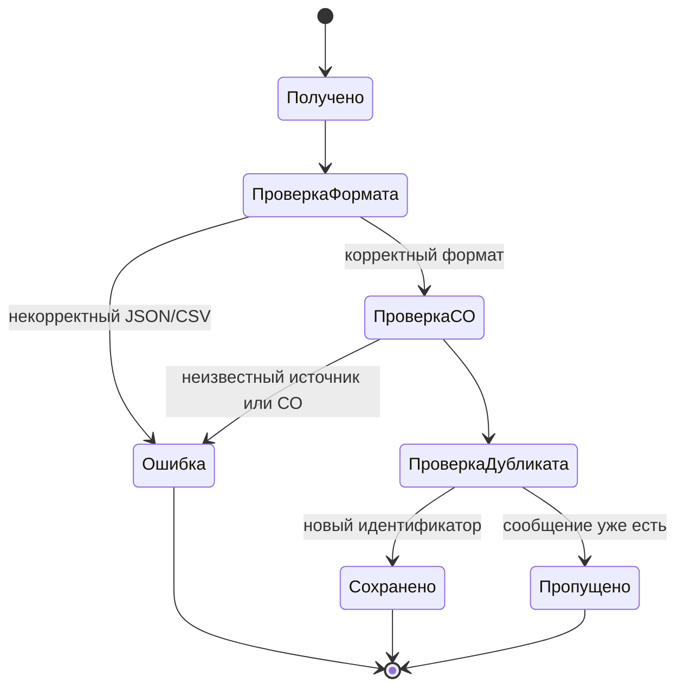
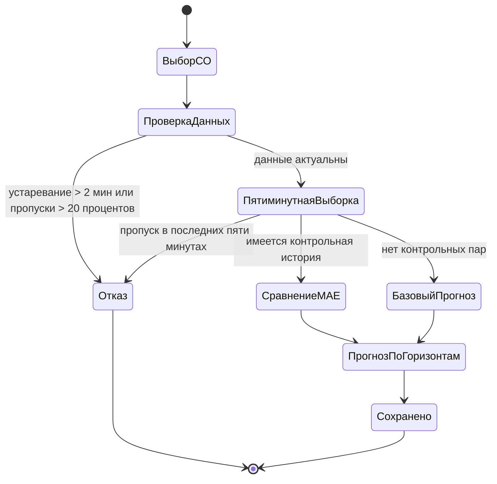
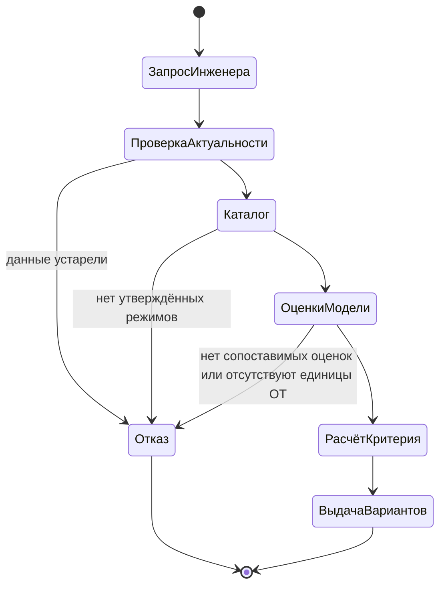
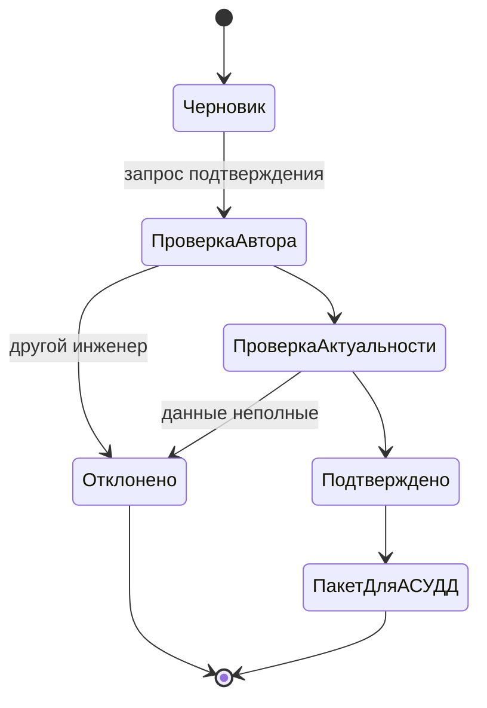
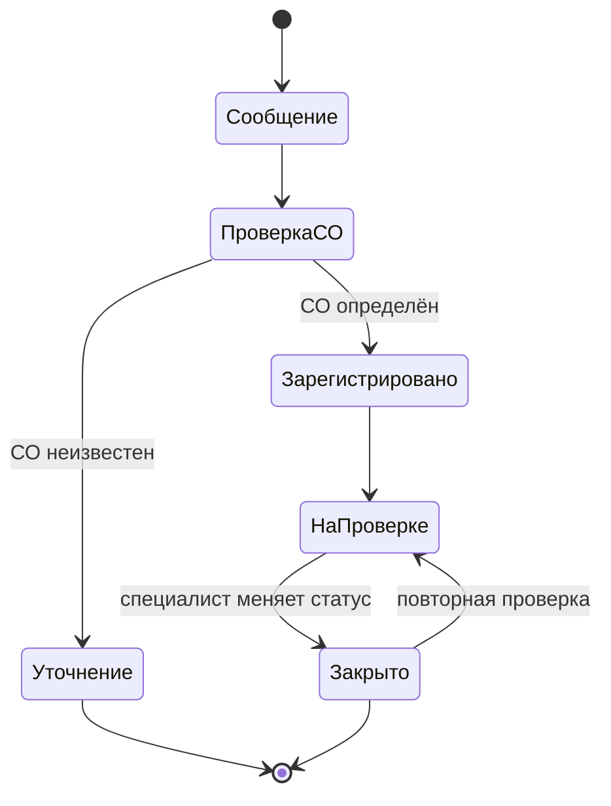
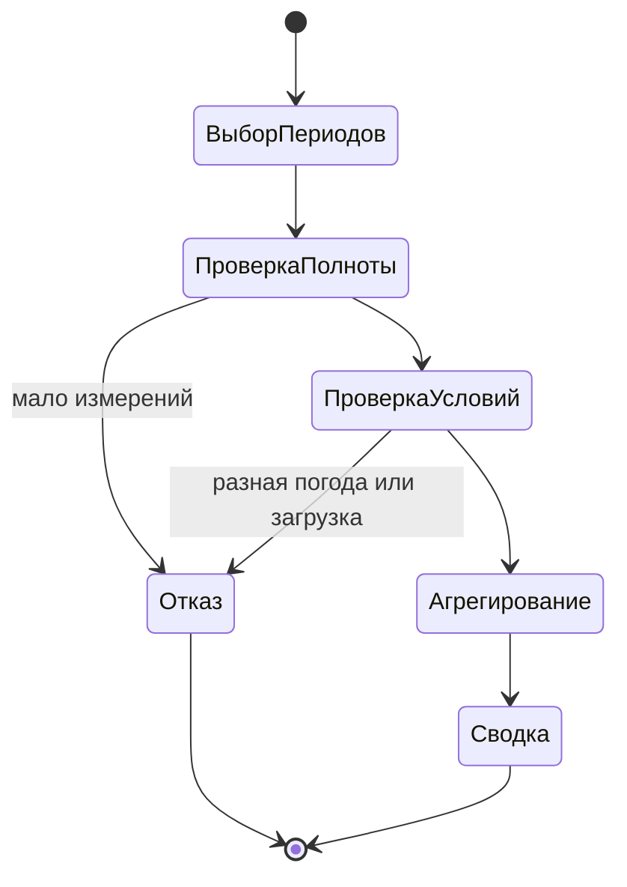
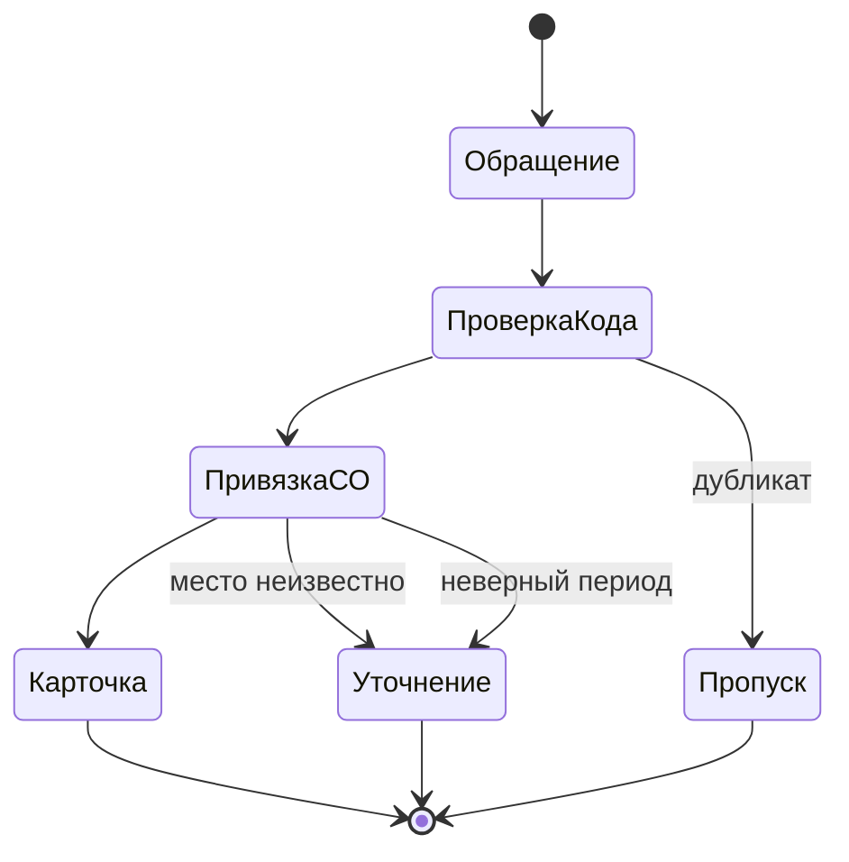

# Алгоритмы автоматизированных функций УСУДТ

Обозначения входов X1-X8 и справочников R1-R2 взяты из ЛР2. Все схемы
показывают логические состояния и ошибки, а не команды контроллерам.

## Ф1. Приём и проверка информации

Вход: X1-X8, R1-R2. Выход: записи БД и сведения об ошибках приёма в ответе API.

## Ф2. Анализ и прогноз движения

Вход: X1-X3, X7, R1, измерения. Выход: прогноз Y5. Горизонты 5/10/15 минут.

## Ф3. Сравнение программ светофоров

Вход: актуальные измерения, утверждённые программы и оценки задержек по четырём видам транспорта. Выход: Y6.

## Ф4. Подтверждение решения

Вход: вариант Y6 и автор. Выход: журнал и пакет Y1. Ввод выполняет инженер через АСУДД. Сравнение имени автора в текущем API не является аутентификацией.

## Ф5. Учёт неисправностей

Вход: X4, X6. Выход: карточка события; передача заявки Y2 подрядчику выполняется вне приложения.

## Ф6. Оценка и отчётность

Вход: архивы измерений и решений, события и погодные условия. Выход: отчёт Y3.

## Ф7. Учёт обращений

Вход: X5, код обращения, время, место. Выход: карточка и аналитические сведения Y4.

Математическое обеспечение: q = 3600*n/T; прогноз по среднему пяти
значений и последнему наблюдению; MAE = sum(abs(y-p))/N;
остаточная очередь Q = max(0, Q_prev+arrivals-served);
J = 0.7*d_auto + 0.3*d_public при стандартных весах.
Все обозначения расшифровываются в отчёте. При обработке событий API проверяет допустимость значения статуса, но не задаёт строгого графа переходов. Анализ обращения, передача сведений дежурному и подготовка ответа выполняются сотрудниками вне API.
