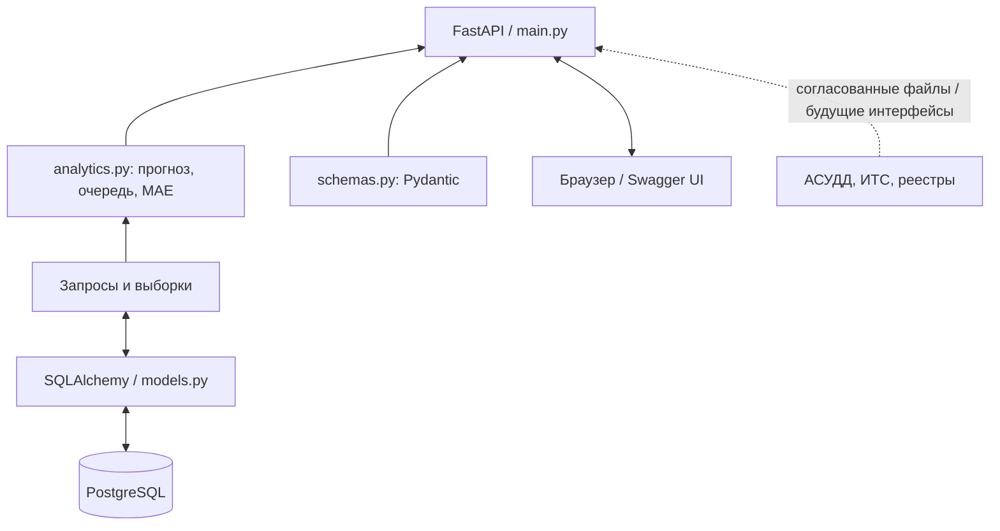

# Структура программного обеспечения

Описаны программные классы `Signal`, `Source`, `Measurement`, `Program`,
`ModelEstimate`, `Forecast`, `Decision`, `Incident`, `Appeal`.
Их связи являются отношениями данных через внешние ключи в PostgreSQL,
не иерархией наследования классов.

Типичные запросы: последние измерения для выбранного СО по `signal_id`
и `observed_at`; утверждённые программы по `signal_id` и `approved`;
оценка задержек по `program_id` и `scenario`; агрегирование количества
обращений и событий по объектам. Индексы для частых временных выборок
описаны в `sql/lab5_indexes.sql`.

УСУДТ не соединяется напрямую с контроллерами. Данные от внешних систем
поступают через согласованные файлы или интерфейсы, которые должны быть
разработаны и проверены отдельно.
