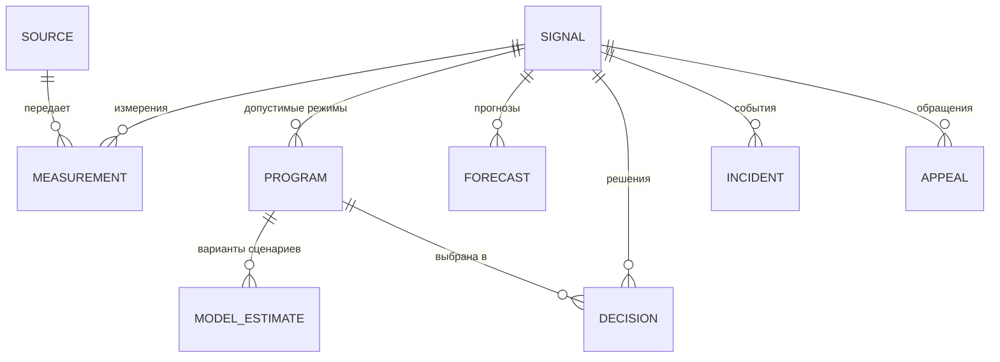
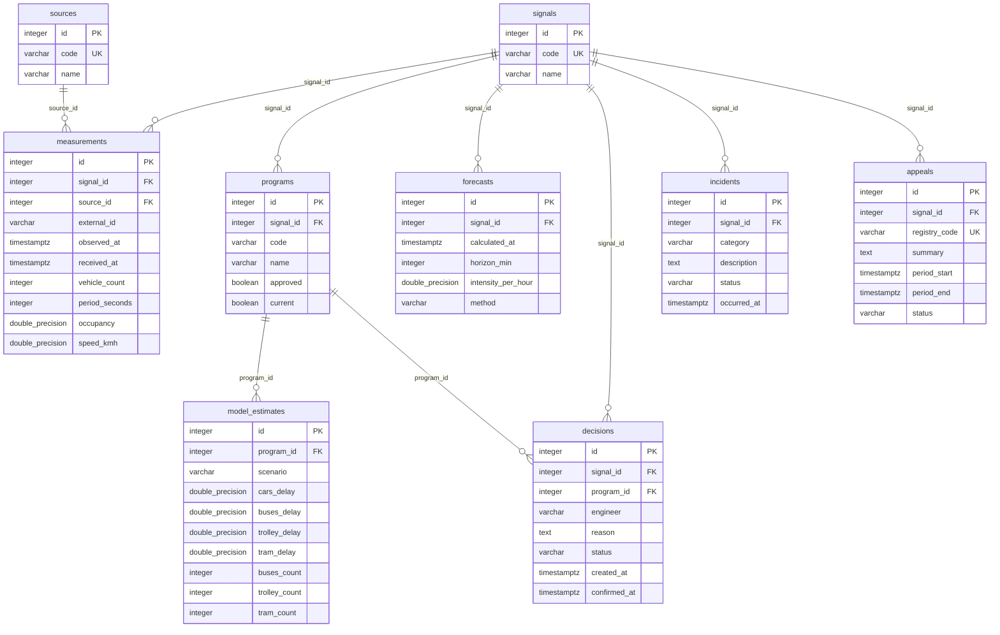

# Модель данных УСУДТ

## Логическая модель

Справочники: светофорный объект, источник данных, программа регулирования.
Оперативные сущности: измерение, оценка транспортной модели, прогноз,
решение инженера, событие, обращение.

## Физическая модель PostgreSQL

Обозначения FK означают внешние ключи, PK первичные ключи, UK уникальные значения.
При поступлении одного идентификатора сообщения от одного источника повторная запись
не создаётся благодаря ограничению `uq_source_message`. Код программы уникален
в пределах конкретного СО. Контактные данные заявителей не хранятся.

Справочники СО и источников вынесены в отдельные таблицы, оценки по сценариям
отделены от программ. В `decisions` поле `signal_id` хранится наряду с `program_id`
для выборки по объекту. При создании решения проверяется соответствие этих ссылок,
поэтому строгая третья нормальная форма всей физической схемы не заявляется.

Составные ограничения уникальности: `(source_id, external_id)`, `(signal_id, code)`,
`(program_id, scenario)`. Первичные и внешние ключи имеют тип INTEGER.
Поля обязательны, кроме `measurements.speed_kmh` и `decisions.confirmed_at`.
Значения `default` в ORM задаются приложением при вставке.
