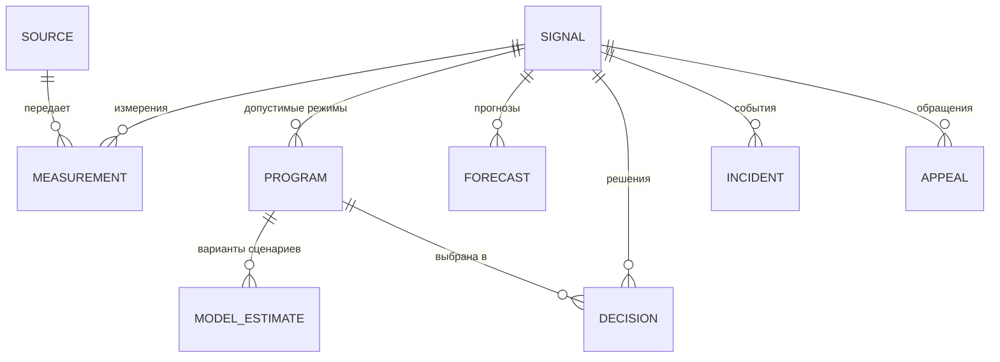
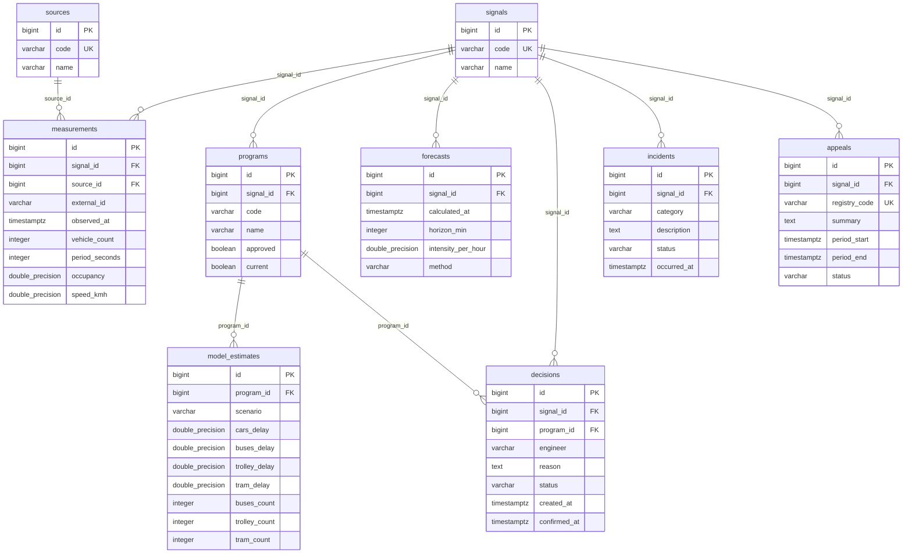

# Модель данных УСУДТ

## Логическая модель

Справочники: светофорный объект, источник данных, программа регулирования.
Оперативные сущности: измерение, оценка транспортной модели, прогноз,
решение инженера, событие, обращение.

## Физическая модель PostgreSQL

Обозначения FK означают внешние ключи, PK первичные ключи, UK уникальные значения.
При поступлении одного идентификатора сообщения от одного источника повторная запись
не создаётся благодаря ограничению `uq_source_message`. Код программы уникален
в пределах конкретного СО. Контактные данные заявителей не хранятся.

Структура находится как минимум в третьей нормальной форме: названия СО и источников
не повторяются в измерениях, сведения о программах не дублируются в решениях,
а оценки по сценариям выделены в отдельную таблицу.
